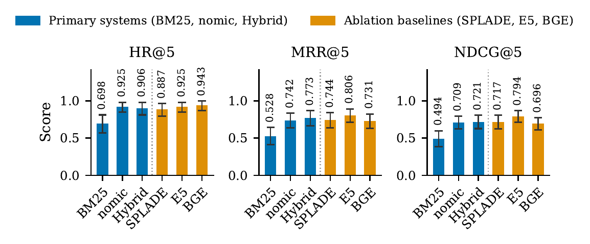

# Sparse, Dense, and Hybrid Retrieval for EU Climate Statutes

**A leakage-controlled evaluation.** Accepted at AICS 2026 (Springer CCIS).

Rameez Wani, Ananya Warior, Mohammed Amine Togou · School of Computing, Dublin City University

This page summarises the findings of the paper. The code, corpus and benchmark are not public; see [Access](#access) below.

---

## The finding in one line

**How a benchmark's questions are worded can decide which retrieval system looks best, more than the systems themselves do.**

When test questions are written while reading the statutes, they borrow the statutes' own words. Keyword search (BM25) then looks almost as good as semantic search. Reword the same questions in plain language, keeping everything else fixed, and the gap opens up.

| Same 71 information needs | Statute-like wording (leaky) | Plain-language wording (controlled) | Change |
|---|---|---|---|
| BM25, MRR@5 | 0.846 | 0.556 | **−0.290** |
| Dense retrieval, MRR@5 | 0.870 | 0.785 | −0.085 |
| BM25, HR@5 | 0.958 | 0.704 | **−0.254** |
| Dense retrieval, HR@5 | 0.986 | 0.958 | −0.028 |

Leakage inflates keyword search about 3.4 times more than semantic search on MRR@5, and about 9 times more on HR@5. Under the leaky wording, all three systems sit within three points of each other, and the benchmark cannot tell them apart.

The effect also shows up on data we never touched. For 29 queries derived from European Parliament written questions, running the *original* question text instead of our plain-language paraphrase raises BM25 by +0.207 HR@5 and +0.271 MRR@5, while dense retrieval stays flat.

## Main results

On a sealed 53-query test set, built under the leakage-controlled protocol:



| System | HR@5 | MRR@5 | NDCG@5 |
|---|---|---|---|
| BM25 | 0.698 | 0.528 | 0.494 |
| Dense (nomic-embed-text-v1.5) | **0.925** | 0.742 | 0.709 |
| Hybrid (weighted RRF) | 0.906 | **0.773** | **0.721** |

- **Semantic retrieval beats keyword search clearly.** Dense and hybrid retrieval each beat BM25 by more than 20 points of HR@5 (McNemar p = 0.002 and p = 0.003). BM25 alone still misses about three queries in ten.
- **Fusion adds no measurable gain over strong dense retrieval.** Dense vs hybrid is not significant on any test (Wilcoxon p = 0.614 on MRR@5). The direction even flipped as the test set grew from 22 to 53 queries, a reminder that small legal-IR comparisons need significance tests.
- **Longer context windows did not help.** Two 512-token encoders (E5-large-v2, BGE-small-v1.5), which truncate a fifth of the corpus, were not significantly worse than the 8,192-token model. On this corpus, an embedding model has to be benchmarked directly, not chosen from its specification sheet.

## Where the best system still fails

Five of the 53 test queries are missed by the hybrid system, for four different reasons:

- **Fusion weighting (2):** BM25's signal either overrides a correct dense result or is itself overridden when it was right.
- **Cross-instrument confusion (1):** neighbouring EU acts share vocabulary, and the encoder ranks the wrong one higher. A different encoder retrieves the right text from the same index.
- **Extreme vocabulary gap (1):** colloquial phrasing sits too far from the legal register.
- **Corpus coverage (1):** the answer is not in the codified text.

None of the failures comes from how documents were chunked.

## What we recommend to practitioners

1. **Control for leakage when you build a benchmark.** Rewrite queries in plain language, and source part of the test set from outside the corpus. Both are cheap and easy to audit.
2. **Start with a strong open-weight bi-encoder.** Treat BM25 fusion as cheap insurance, not a requirement, and tune it if you use it. With the literature default (k = 60, equal weights), validation HR@5 drops from 1.000 to 0.898.
3. **Test for significance.** At this scale, "fusion helps" and "fusion hurts" can both be noise.

## Setting

- **Corpus:** 1,156 article-level provisions from 72 EU climate and energy instruments (ETS, CBAM, Taxonomy, LULUCF, F-Gas, Maritime MRV, ESR, the European Climate Law and others), collected from the EU's official legal repository.
- **Benchmark:** 102 queries with instrument-level relevance judgements. Of the 53 test queries, 31 are derived from documented European Parliament written questions.
- **Systems:** BM25, SPLADE, a dense bi-encoder, weighted Reciprocal Rank Fusion, and two alternative encoders as an ablation.
- **Statistics:** bootstrap and cluster-bootstrap confidence intervals, exact McNemar and Wilcoxon signed-rank tests, and Holm-Bonferroni correction.
- **Compute:** consumer CPUs only. No GPUs and no paid APIs.

## Limitations

- At 53 test queries the confidence intervals are wide, so a null result cannot rule out a small true effect.
- Relevance is judged at the level of whole instruments, not individual articles.
- A second annotator, a practising energy-arbitration lawyer, reached κ = 0.42 on a 14-query overlap. Agreement was κ = 0.62 at the level of legislative families, because most disagreements were about whether closely related acts also count.
- The study covers one domain, one language and general-domain encoders only.

## What comes next

A citation can be correct without being faithful: it points to a law that supports the answer, but the answer actually came from what the model already knew. The next step tests whether statute-worded questions make citations look more trustworthy than they are, and whether an agentic retrieval loop helps. That loop would search again when the evidence is thin and check each cited provision before answering.

## Access

The implementation, corpus, benchmark and relevance judgements are not publicly released. Researchers who want to reproduce or build on this work can contact the authors at rameezshafat.wani2@mail.dcu.ie.

## Citation

```bibtex
@inproceedings{wani2026leakage,
  title     = {Sparse, Dense, and Hybrid Retrieval for {EU} Climate Statutes:
               A Leakage-Controlled Evaluation},
  author    = {Wani, Rameez and Warior, Ananya and Togou, Mohammed Amine},
  booktitle = {Artificial Intelligence and Cognitive Science (AICS 2026)},
  series    = {Communications in Computer and Information Science},
  publisher = {Springer},
  year      = {2026},
  note      = {To appear}
}
```

---

© 2026 the authors. All rights reserved. This summary may be quoted with attribution; no licence is granted for the underlying code or data.
